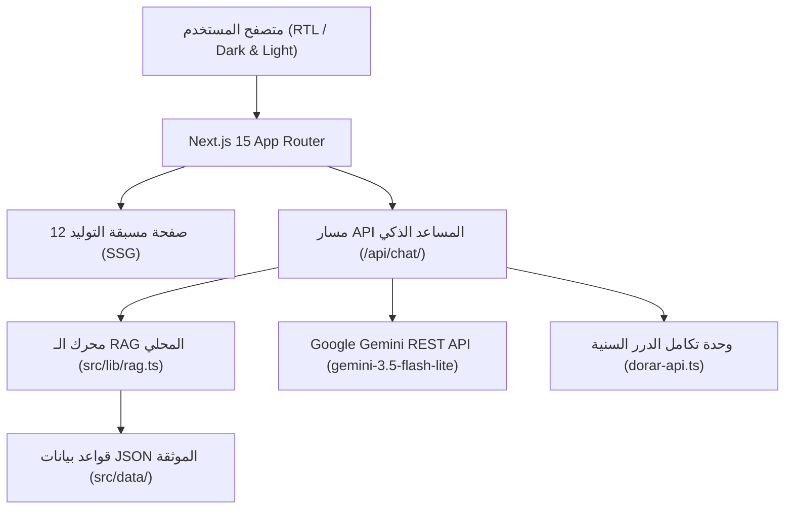
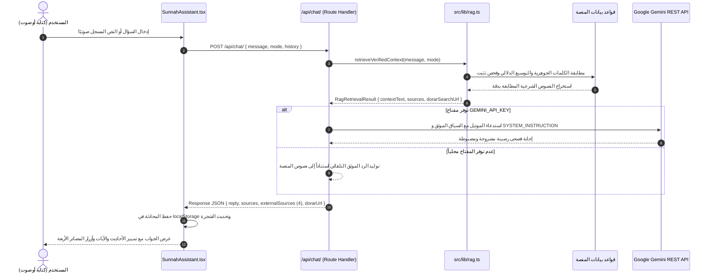

# التقرير التقني والمعماري الشامل لمشروع «الباحث في السنة» (Al-Bahith fi Al-Sunnah)

> **تاريخ إعداد التقرير:** 20 نوفمبر 2026  
> **حالة المشروع:** جاهز للإنتاج (Production Ready)  
> **المستودع البرمجي:** `https://github.com/a0hv/Sunnah.git` (الفرع الأساسي: `main`)  
> **البيئة المستهدفة:** منصة Vercel (Next.js Hybrid: Static Pages + Serverless RAG API)

---

## فهرس التقرير

1. [نظرة عامة والبنية التقنية (Tech Stack & Configuration)](#1-نظرة-عامة-والبنية-التقنية-tech-stack--configuration)
2. [خريطة الملفات والمجلدات الكاملة (Project Map)](#2-خريطة-الملفات-والمجلدات-الكاملة-project-map)
3. [شرح تفصيلي لكل صفحة وقسم في الموقع (Pages & Features)](#3-شرح-تفصيلي-لكل-صفحة-وقسم-في-الموقع-pages--features)
4. [المساعد الذكي ومحرك الـ RAG والـ API](#4-المساعد-الذكي-ومحرك-الـ-rag-والـ-api)
5. [قواعد البيانات المحلية والتوثيق العلمي (Local Databases)](#5-قواعد-البيانات-المحلية-والتوثيق-العلمي-local-databases)
6. [الميزات والمكونات المشتركة والأدوات المساعدة (Shared Utilities)](#6-الميزات-والمكونات-المشتركة-والأدوات-المساعدة-shared-utilities)
7. [متغيرات البيئة والأمان والنشر (Security & Deployment)](#7-متغيرات-البيئة-والأمان-والنشر-security--deployment)
8. [الملاحظات التقنية والتوصيات المستقبلية](#8-الملاحظات-التقنية-والتوصيات-المستقبلية)

---

## 1. نظرة عامة والبنية التقنية (Tech Stack & Configuration)

منصة **«الباحث في السنة»** هي مرجع رقمي إسلامي عصري متكامل، يهدف إلى الجمع بين أصول الحديث النبوي الشريف وشروحه، العقيدة، السيرة النبوية، أذكار اليوم والليلة، صيانة الحديث عبر التثبت العلمي، وتطبيقات العمل اليومي بهدي الحبيب ﷺ.



### 1.1 إصدارات الحزم والمكتبات البرمجية (`package.json`)

| الحزمة (Package) | الإصدار (Version) | النوع | الدور والوظيفة داخل المشروع |
| :--- | :---: | :---: | :--- |
| **Next.js** | `^15.1.7` | أساسي | إطار العمل الرئيسي (App Router) لتوليد الصفحات وتقديم مسار API الخادم. |
| **React** | `^19.0.0` | أساسي | مكتبة واجهات المستخدم، مع استخدام React 19 Hooks الحديثة (`useTransition`, `useCallback`, `useMemo`). |
| **React-DOM** | `^19.0.0` | أساسي | محرك العرض على المتصفح المتوافق مع React 19. |
| **Lucide React** | `^1.16.0` | أساسي | حزمة أيقونات الواجهة التفاعلية خفيفة الوزن ذات المظهر العصري. |
| **Fast XML Parser** | `^4.5.3` | أساسي | مكتبة معالجة XML (استُخدمت في بناء فهارس المصادر الخام مسبقاً). |
| **JSZip** | `^3.10.1` | أساسي | مكتبة ضغط الملفات وقراءتها (أداة مساعدة لأرشفة البيانات). |
| **TypeScript** | `^5.7.3` | تطوير | نظام الأنواع الصارم (Strict Mode) لمنع الأخطاء البرمجية أثناء الترجمة. |
| **Tailwind CSS** | `^3.4.17` | تطوير | إطار تنسيق CSS المعتمد على الأدوات المساعدة وخصائص RTL المنطقية. |
| **PostCSS** | `^8.5.2` | تطوير | معالج CSS لتوليد الأنماط المتوافقة مع المتصفحات. |
| **Autoprefixer** | `^10.4.20` | تطوير | إضافة البادئات الخاصة بالمتصفحات تلقائيًا للأنماط المتقدمة. |

### 1.2 إعدادات البناء والنشر (`next.config.ts` & Vercel)
- **إضافة الشرطة المائلة (`trailingSlash: true`):** تضمن توحيد الروابط على خوادم Vercel وتفادي مشاكل إعادة التوجيه في المسارات الثابتة والـ API (`/api/chat/`).
- **تحسين الصور (`images: { unoptimized: true }`):** إلغاء المعالجة السيرفرية المكلفة للصور، مما يضمن أقصى سرعة استجابة وخفض استهلاك موارد السيرفر إلى الصفر.
- **نمط الصفحات الهجين (Hybrid Deployment):**
  - **12 مساراً ثابتاً (Static SSG):** يتم توليدها مسبقاً بنسبة 100% أثناء البناء (`npm run build`) وتُقدّم عبر شبكة الـ CDN العالمية لـ Vercel بسرعة خاطفة (`/`, `/about`, `/adhkar`, `/daily-tracker`, `/nawawi40`, `/search`, `/seerah`, `/verify`, `/_not-found`, `/icon.svg`).
  - **مسار ديناميكي سيرفرلس (`/api/chat`):** يعمل كـ Node.js Route Handler ديناميكي (`export const dynamic = 'force-dynamic'` مع `maxDuration = 30`) لاستقبال أسئلة المستخدم وتشغيل محرك الـ RAG والتواصل مع Gemini API.

### 1.3 نظام الخطوط المحلية الثلاثي (The 3-Font System)
تم تطبيق نظام طباعي إسلامي-عصري دقيق يفصل بين هوية الواجهة ونصوص الوحي الشريف:

1. **خط ثمانية (Thmanyah Font Family) — لهوية الواجهة والعناوين والنصوص العامة:**
   - **`Thmanyah Display` (للعناوين الرئيسية):** متوفر بـ 5 أوزان رسمية (`Black`, `Bold`, `Medium`, `Regular`, `Light`) في مجلد `public/fonts/thmanyah-serif-display-*.woff2`.
   - **`Thmanyah Text` (للنصوص والشروح والفقرات المطولة):** متوفر بـ 5 أوزان في `public/fonts/thmanyah-serif-text-*.woff2` مع ارتفاع سطر رحب (`line-height: 2`).
   - **`Thmanyah Sans` (للأزرار والبطاقات وعناصر الواجهة الرقمية):** متوفر بـ 5 أوزان في `public/fonts/thmanyah-sans-*.woff2`.
2. **خط لوتس / الأميري (Lotus / Amiri Font) — لنصوص الأحاديث النبوية الشريفة:**
   - تم ربطه عبر حزمة `next/font/google` لخط `Amiri` بوزنين (`400`, `700`) مع المتغير الطباعي `--font-hadith` وخاصية `display: 'swap'`.
   - كما يتوفر ملف خط `public/fonts/lotus-naskh.ttf` (بحجم 150.7 ك.ب) كبديل نَسخي موثوق.
   - يُطبّق عبر الفئة `.font-hadith` بارتفاع سطر فسيح ومريح للقراءة (`line-height: 2.85 !important`).
3. **الخط العثماني (Uthmanic Hafs Font) — للآيات القرآنية الكريمة:**
   - ملف الخط الفعلي: `public/fonts/uthmanic-hafs-v20.ttf` (بحجم 293.3 ك.ب).
   - مُعرّف بقاعدة `@font-face` باسم `UthmanicHafs`.
   - يُطبّق تلقائياً على كل آية محصورة بين قوسي التنزيل `﴿...﴾` عبر الفئة `.font-quran` بارتفاع سطر (`line-height: 2.6 !important`).

### 1.4 نظام الألوان والوضعين النهاري والليلي وتفادي الوميض (No-FOUC)
- **لوحة الألوان المستوحاة من التراث الورقي الإسلامي والطبيعة:**
  - **خلفية الورق (Paper):** النهاري `#FAF9F5` (ورق كريمي دافئ مريح للعين) | الليلي `#0E1412` (فحمي ليلي هادئ مائل للخضرة).
  - **الأسطح والبطاقات (Surface):** النهاري `#FFFFFF` | الليلي `#151E1B`.
  - **النصوص الأساسية (Charcoal):** النهاري `#1A1F1C` | الليلي `#EAECE9`.
  - **النصوص الثانوية (Muted):** النهاري `#526058` | الليلي `#94A39D`.
  - **اللون الزمردي النبوي (Emerald Brand):** النهاري `#0F5C4A` | الليلي `#34A88B`.
  - **اللون الذهبي العتيق (Gold Accent):** النهاري `#A67C2E` | الليلي `#D4AF63`.
  - **الحدود الشعرية (Subtle Border):** النهاري `#E6E2D8` | الليلي `#23302B`.
- **معالجة الوميض المزعج (No-FOUC Script):** تم حقن نص برمجي ذاتي التنفيذ (IIFE) خفيف ومباشر داخل وسم `<head>` في `src/app/layout.tsx`. يقوم النص بفحص `localStorage.getItem('theme')` ومطابقة تفضيلات النظام `prefers-color-scheme: dark` قبل بدء تصيير الشجرة (Render Tree)، ويضيف فئة `.dark` إلى عنصر `<html>` فوراً قبل ظهور أول بكسل على الشاشة، مما يضمن انعدام الوميض بنسبة 100%.

### 1.5 التدقيق الصارم لقواعد الاتجاه العربي (RTL Logical Properties Audit)
تم إجراء تدقيق برمجي شامل لكافة ملفات الكود في مجلد `src/`:
- **عدد استخدامات الخصائص الفيزيائية غير المنطقية (`left` و `right` في الـ CSS):** **صفر تماماً (0)**.
- جميع المسافات والهوامش والحدود والمحاذاة تعتمد حصرياً على الخصائص المنطقية الحديثة:
  - `ms-*` (Margin-Inline-Start) و `me-*` (Margin-Inline-End) بدلاً من `ml` و `mr`.
  - `ps-*` (Padding-Inline-Start) و `pe-*` (Padding-Inline-End) بدلاً من `pl` و `pr`.
  - `start-*` و `end-*` لتحديد المواضع المطلقة والمثبتة بدلاً من `left` و `right`.
  - `text-start` و `text-end` و `border-s-*` و `border-e-*`.
  - ورود كلمتي `left` و `right` في الشيفرة محصور حصراً في استيراد أيقونات سهم التوجيه في Lucide (`ArrowLeft`, `ChevronLeft`, `ArrowRight` مع تدوير `rtl:rotate-180`) أو في التعليقات البرمجية الإيضاحية.

---

## 2. خريطة الملفات والمجلدات الكاملة (Project Map)

```
Sunnah/
├── public/
│   ├── fonts/
│   │   ├── lotus-naskh.ttf                        # خط لوتس النسخي للأحاديث (150.7 KB)
│   │   ├── thmanyah-sans-*.woff2 (5 أوزان)        # خط ثمانية الرقمي للواجهة
│   │   ├── thmanyah-serif-display-*.woff2 (5 أوزان)# خط ثمانية للعناوين البارزة
│   │   ├── thmanyah-serif-text-*.woff2 (5 أوزان)   # خط ثمانية للنصوص والشروح
│   │   └── uthmanic-hafs-v20.ttf                  # الخط العثماني للآيات القرآنية (293.3 KB)
│   └── icon.svg                                   # شعار وهوية المنصة المتجهي (Favicon)
├── scripts/
│   ├── build-quran-index.mjs                      # سكربت توليد الفهرس القرآني للربط التلقائي
│   ├── fetch-dorar-fake.mjs                       # سكربت جلب أحاديث قسم تثبت من الدرر السنية
│   ├── fetch-hadeethenc.mjs                       # سكربت أرشيفي لموسوعة الأحاديث
│   ├── fetch-hisn.mjs                             # سكربت جلب وتبويب حصن المسلم
│   └── fetch-nawawi40.mjs                         # سكربت مراجعة نصوص الأربعين النووية
├── src/
│   ├── app/
│   │   ├── about/page.tsx                         # صفحة التعريف والمنهج العلمي للمنصة
│   │   ├── adhkar/page.tsx                        # صفحة كتاب حصن المسلم (خادم التوجيه)
│   │   ├── api/
│   │   │   └── chat/route.ts                      # مسار API المساعد الذكي، RAG، وتشخيص Gemini
│   │   ├── daily-tracker/page.tsx                 # صفحة متتبع سنن اليوم والليلة
│   │   ├── nawawi40/page.tsx                      # صفحة الأربعين النووية والتسميع
│   │   ├── search/page.tsx                        # صفحة محرك البحث الموحد والتوسيع الدلالي
│   │   ├── seerah/page.tsx                        # صفحة السيرة النبوية التفاعلية (الرحيق المختوم)
│   │   ├── verify/page.tsx                        # صفحة قسم تثبّت للأحاديث المنتشرة التي لا تصح
│   │   ├── globals.css                            # أنماط CSS العامة، الخطوط، المتغيرات، وشريط التمرير
│   │   ├── icon.svg                               # أيقونة Next.js Metadata Route
│   │   ├── layout.tsx                             # القالب العام: الرأس، No-FOUC، الملاحة، والتذييل
│   │   ├── not-found.tsx                          # صفحة الخطأ 404 بروابط العودة السريعة
│   │   └── page.tsx                               # الصفحة الرئيسية والمساعد الذكي في الهيرو
│   ├── components/
│   │   ├── AdhkarClient.tsx                       # واجهة حصن المسلم: 133 باباً، عداد تسبيح بالاهتزاز
│   │   ├── BrandLogo.tsx                          # مكون الشعار المتجهي (محراب، مصحف، ماسة ذهبية)
│   │   ├── ComingSoon.tsx                         # مكون صفحات قيد الإنشاء (غير مستخدم حاليًا)
│   │   ├── DailyTrackerClient.tsx                 # جدول متابعة سنن اليوم (12 محطة مع عداد الأيام)
│   │   ├── FiqhBadge.tsx                          # شارات مراتب ودرجات الأحاديث وتصنيفها الفقهي
│   │   ├── FloatingAssistant.tsx                  # الزر العائم لفتح المساعد في الصفحات الداخلية
│   │   ├── Footer.tsx                             # التذييل التحريري والمصادر العلمية
│   │   ├── FormattedArabicText.tsx                # منسق النصوص مع ربط الآيات التلقائي بـ Quran.com
│   │   ├── HadithOfTheDay.tsx                     # بطاقة حديث اليوم من النووية مع التوليد الحتمي
│   │   ├── HadithText.tsx                         # محرك تحليل الحديث وتمييز كلام النبي ﷺ
│   │   ├── MobileBottomNav.tsx                    # شريط الملاحة السفلي المريح لشاشات الجوال
│   │   ├── Navbar.tsx                             # الشريط العلوي مع الروابط وتبديل المظهر والبحث
│   │   ├── NawawiClient.tsx                       # واجهة الأربعين النووية مع وضع التسميع الذاتي
│   │   ├── SearchClient.tsx                       # محرك البحث الشامل مع الإكمال التلقائي والإبراز
│   │   ├── SeerahClient.tsx                       # الخط الزمني للسيرة: 6 حقب و 30 محطة كبرى
│   │   ├── ShareCardModal.tsx                     # نافذة تخصيص وتصدير بطاقات المشاركة لواتساب
│   │   ├── SunnahAssistant.tsx                    # المساعد الذكي الموحد: تاريخ، صوت، نطاقات، مصادر 4
│   │   ├── ThemeProvider.tsx                      # مزود حالة الوضع الليلي والنهاري
│   │   ├── ThemeToggle.tsx                        # زر التبديل السلس بين المظهرين
│   │   └── VerifyClient.tsx                       # واجهة قسم تثبّت والبدائل الصحيحة الثابتة
│   ├── data/
│   │   ├── daily-sunnah.json                      # بيانات سنن اليوم والليلة (12 محطة تفصيلية)
│   │   ├── fake-hadiths.json                      # بيانات أحاديث لا تصح من الدرر السنية (150 حديثاً)
│   │   ├── hisn-al-muslim.json                    # كتاب حصن المسلم كاملاً (133 باباً و 302 ذكراً)
│   │   ├── nawawi40.json                          # نصوص الأربعين النووية كاملة (42 حديثاً جامعاً)
│   │   ├── quran-index.json                       # فهرس القرآن الكريم (6236 آية) للربط التلقائي
│   │   └── seerah.json                            # السيرة النبوية (6 حقب و 30 محطة كبرى)
│   ├── lib/
│   │   ├── arabic-search.tsx                      # دوال البحث، التطبيع العربي، وإبراز الكلمات
│   │   ├── dorar-api.ts                           # وحدة تكامل الدرر السنية وبناء الروابط الذكية
│   │   ├── external-refs.ts                       # استخراج روابط التحقق المباشرة من الدرر ومصحف القرآن
│   │   ├── rag.ts                                 # محرك الاسترجاع الدلالي المعزز وتصفية النطاقات
│   │   └── render-share-card.ts                   # محرك رسم البطاقات بتقنية HTML5 Canvas
│   └── types/
│       ├── book.ts                                # تعريفات أنواع بيانات الأذكار، الأحاديث، وتثبت
│       └── seerah.ts                              # تعريفات أنواع السيرة، الحقب، والمحطات
├── .env.local.example                             # نموذج متغيرات البيئة الآمن الخالي من الأسرار
├── .gitignore                                     # استبعاد المفاتيح والكاش والملفات المؤقتة
├── next.config.ts                                 # إعدادات النشر على Next.js و Vercel
├── package.json                                   # الحزم والمكتبات وأوامر التشغيل
├── tailwind.config.ts                             # تكوين الألوان والخطوط والفئات الممتدة
└── tsconfig.json                                  # تكوين مترجم TypeScript والمسارات البديلة (@/*)
```

---

## 3. شرح تفصيلي لكل صفحة وقسم في الموقع (Pages & Features)

### 3.1 الصفحة الرئيسية (`/` — `src/app/page.tsx`)
- **الوظيفة:** الواجهة الأساسية التي تبرز هوية المنصة، وتتيح الوصول الفوري للمساعد الذكي المدمج في واجهة البداية، مع عرض الأركان الخمسة، وبطاقة حديث اليوم، وشريط متتبع السنن اليومية.
- **المكونات المستخدمة:** `SunnahAssistant`، `HadithOfTheDay`، `BrandLogo`، روابط الأقسام المباشرة، وأيقونات Lucide.
- **ملفات البيانات المرتبطة:** `nawawi40.json` (لحديث اليوم)، إضافة لقواعد البيانات عبر المساعد.
- **الميزات التفاعلية:** محادثة فورية مع المساعد الذكي، توليد حديث اليوم الحتمي، تبديل عشوائي لحديث اليوم مع اهتزاز لمسي (`haptic vibration`)، وروابط الانتقال السريع.
- **مفاتيح `localStorage`:** لا تستخدم مفاتيح خاصة بها مباشرة؛ تعتمد على مفاتيح المكونات الفرعية.

### 3.2 صفحة كتاب حصن المسلم (`/adhkar` — `AdhkarClient.tsx`)
- **الوظيفة:** عرض كتاب «حصن المسلم من أذكار الكتاب والسنة» كاملاً، بتبويب موضوعي عصري يشمل 133 باباً و 302 ذكراً مأثوراً.
- **المكونات المستخدمة:** `AdhkarClient`، `ShareCardModal`، روابط الدرر السنية.
- **ملفات البيانات المرتبطة:** `src/data/hisn-al-muslim.json`.
- **الميزات التفاعلية:**
  - القفز السريع للأبواب الشهيرة (الاستيقاظ، الصباح والمساء، النوم، الكرب، السفر، الطعام، الاستغفار).
  - دعم وسيط الرابط `?cat=ID` للفتح المباشر للباب من المساعد الذكي أو محرك البحث.
  - عدّاد تسبيح تفاعلي لكل ذكر مع دائرة تقدم مرئية واهتزاز لمسي عند كل ضغطة (`navigator.vibrate(20)` وعند الاكتمال `[40, 60, 40]`).
  - زر إعادة ضبط العداد للذكر المفرد أو للباب بأكمله.
  - تصفية وبحث لحظي في عناوين الأبواب ونصوص الأذكار.
  - نسخ منسق مع الإحالة، وتوليد بطاقة مشاركة لواتساب.
- **مفاتيح `localStorage` المستعملة:**
  - `adhkar_daily_progress`: يحفظ كائن التقدم اليومي `{ date: "YYYY-MM-DD", counts: { [dhikrId]: count } }` مع إعادة تصفير تلقائي مع بزوغ فجر كل يوم جديد.

### 3.3 صفحة السيرة النبوية المطهرة (`/seerah` — `SeerahClient.tsx`)
- **الوظيفة:** استعراض تاريخي وتربوي متسلسل لحياة المصطفى ﷺ من المولد الشريف حتى الرفيق الأعلى، مستند إلى كتاب «الرحيق المختوم» للمباركفوري.
- **المكونات المستخدمة:** `SeerahClient`، `FormattedArabicText`، `ShareCardModal`.
- **ملفات البيانات المرتبطة:** `src/data/seerah.json`.
- **الميزات التفاعلية:**
  - تقسيم السيرة إلى 6 حقب زمنية كبرى مع شريط زمني تفاعلي.
  - 30 محطة تاريخية مفصلة تتضمن: التاريخ الهجري والميلادي، الموقع الجغرافي، تصنيف الحدث (غزوة، معاهدة، مرحلة، حدث مفصلي).
  - تفاصيل موسعة لكل محطة: العرض التاريخي، الدروس والعبر التربوية، الشخصيات المحورية، والآيات القرآنية المرتبطة مع ربطها تلقائيًا بـ `Quran.com`.
  - ميزة رصد الإنجاز التعليمي («تمت دراسته») مع شريط نسبة تقدم مرئي.
- **مفاتيح `localStorage` المستعملة:**
  - `seerah_completed_milestones`: يحفظ خريطة المحطات المكتملة دراستها بصيغة `{ [milestoneId]: true }`.

### 3.4 صفحة الأربعون النووية والتسميع الذاتي (`/nawawi40` — `NawawiClient.tsx`)
- **الوظيفة:** عرض الأحاديث الجامعة للإمام النووي (42 حديثاً) التي عليها مدار الإسلام، مع نظام تسميع ذاتي متطور ورصد الحفظ الفردي.
- **المكونات المستخدمة:** `NawawiClient`، `HadithText`، `FormattedArabicText`، `ShareCardModal`.
- **ملفات البيانات المرتبطة:** `src/data/nawawi40.json`.
- **الميزات التفاعلية:**
  - **وضع التسميع الذاتي (Recitation / Testing Mode):** إمكانية إخفاء متن الحديث بالكامل (ضبابية بصرية Blur) لاختبار حفظ الطالب، مع زر كشف المتن للتحقق من الضبط.
  - نظام تصنيف الحفظ لكل حديث: (لم يبدأ • جاري الحفظ • تم الحفظ بنجاح).
  - لوحة إحصاءات الحفظ: نسبة مئوية، عدد الأحاديث المحفوظة، وتصفية القائمة بحسب حالة الحفظ.
  - تمييز كلام النبي ﷺ بلون زمردي عبر `HadithText`.
  - التحقق المباشر من تخريج الحديث في الدرر السنية.
- **مفاتيح `localStorage` المستعملة:**
  - `nawawi40_memorization_progress`: يخزن سجل حالات الحفظ لجميع الأحاديث `{ [hadithId]: 'unmemorized' | 'in_progress' | 'memorized' }`.

### 3.5 صفحة قسم تثبّت للأحاديث التي لا تصح (`/verify` — `VerifyClient.tsx`)
- **الوظيفة:** صيانة الجناب النبوي الشريف وبيان الأحاديث المكذوبة والضعيفة والباطلة المشتهرة بين الناس، مع تقديم البديل الصحيح الثابت بدقة علمية.
- **المكونات المستخدمة:** `VerifyClient`، `FiqhBadge`، `ShareCardModal`.
- **ملفات البيانات المرتبطة:** `src/data/fake-hadiths.json`.
- **الميزات التفاعلية:**
  - البحث الفوري في 150 حديثاً مشتهراً لا يصح بحسب تحقيق «الدرر السنية».
  - **طريقة العرض المقارن (Comparative Pairs):** بطاقات عرض متقابلة تضع الحديث غير الثابت محفوفاً بالتحذير الأحمر، وإلى جانبه مباشرة البديل الصحيح الثابت مع راويه ومخرجه.
  - إشارات مراتب التحقيق الفقهي (موضوع، باطل، ضعيف جداً، لا أصل له) عبر `FiqhBadge`.
  - روابط تحقق مباشرة بالكلمات في الموسوعة الحديثية.
- **مفاتيح `localStorage` المستعملة:** لا توجد (أداة استرشادية مرجعية لا تتطلب تخزين حالة محلية).

### 3.6 صفحة متتبع سنن اليوم والليلة (`/daily-tracker` — `DailyTrackerClient.tsx`)
- **الوظيفة:** مرافقة المسلم على مدار 24 ساعة لتوثيق تطبيقه للسنن النبوية العملية من لحظة الاستيقاظ وحتى النوم.
- **المكونات المستخدمة:** `DailyTrackerClient`.
- **ملفات البيانات المرتبطة:** `src/data/daily-sunnah.json`.
- **الميزات التفاعلية:**
  - 12 محطة زمنية تشمل: الاستيقاظ، الفجر وأذكار الصباح، الضحى والعمل، الظهر، العصر، المغرب، العشاء، أذكار المساء، قيام الليل، وأذكار النوم.
  - رصد إنجاز السنن مع شريط دائري وتحديث فوري.
  - عداد الاستمرارية (Streak Count) لتشجيع المسلم على المداومة اليومية.
  - ربط مباشر بين كل محطة وبين أبوابها الخاصة في كتاب حصن المسلم (`/adhkar?cat=ID`).
  - تصفية المحطات بحسب وقت اليوم (الصباح • العمل والظهيرة • المساء والليل).
- **مفاتيح `localStorage` المستعملة:**
  - `daily_sunnah_tracker_data`: يخزن بيانات التقدم `{ date: "YYYY-MM-DD", completed: string[], streak: number }`.

### 3.7 صفحة محرك البحث الموحد والتوسيع الدلالي (`/search` — `SearchClient.tsx`)
- **الوظيفة:** محرك بحث فوري شامل يبحث عبر كافة قواعد بيانات المنصة في وقت متزامن بدون الحاجة لاستدعاء أي خادم خارجي.
- **المكونات المستخدمة:** `SearchClient`، `HighlightArabicText`، `FormattedArabicText`، `ShareCardModal`.
- **ملفات البيانات المرتبطة:** كافة ملفات `src/data/*.json` عبر `src/lib/arabic-search.tsx`.
- **الميزات التفاعلية:**
  - بحث عالي السرعة مع تأخير مهدئ (Debounce 180ms) و React `useTransition`.
  - دعم التوسيع الدلالي للمفردات والمشاعر والحالات النفسية بالعامية والفصحى (مثل: «مخنوق وحزين»، «عندي دين وعايز رزق»، «مشاكل مع مراتي»، «كابوس في النوم»، «متعصب»).
  - تصنيف النتائج في تبويبات: (الكل • الأربعون النووية • حصن المسلم • السيرة النبوية • قسم تثبّت).
  - تمييز وإبراز الكلمات المطابقة داخل النصوص بواسطة الوسم المخصص `<mark>`.
- **مفاتيح `localStorage` المستعملة:** لا توجد (تعتمد على وسائط شريط العناوين `?q=...`).

### 3.8 صفحة التعريف والمنهجية العلمية (`/about` — `src/app/about/page.tsx`)
- **الوظيفة:** استعراض رؤية ورسالة المشروع، والتأكيد على التزامه بالأمانة العلمية والتخريج المعتمد، وتوثيق المصادر الخمسة الكبرى للمنصة.

---

## 4. المساعد الذكي ومحرك الـ RAG والـ API

المساعد الذكي في منصة «الباحث في السنة» ليس مجرد روبوت محادثة عام، بل هو **نظام استرجاع دلالي معزز ومحصور (Strict Grounded RAG)** صُمم وفق أعلى معايير الضبط الشرعي لمنع الهلوسة وصيانة نصوص الوحي.



### 4.1 واجهة المحادثة التحريرية (`SunnahAssistant.tsx`)
- **سجل المحادثات وتعدد الجلسات (`localStorage`):**
  - يتم استخراج عنوان ذكي للمحادثة تلقائياً من أول استفسار يطرحه المستخدم.
  - تخزن الجلسات محلياً في مفتاح `sunnah_assistant_conversations_v2` مع حفظ معرف الجلسة النشطة في `sunnah_assistant_current_conv_id`.
  - واجهة درج جانبي (Drawer) من جهة البداية (`start`) للتبديل بين المحادثات السابقة، حذف جلسة محددة، أو بدء جلسة جديدة.
- **محدد نطاق البحث (`mode`):**
  - أزرار سريعة لاختيار تخصص السؤال: (`الكل` • `الأذكار` • `السيرة` • `الحديث` • `معلومات عامة`).
- **الإدخال الصوتي باللغة العربية (Voice Input):**
  - تكامل مباشر مع `Web Speech API` القياسي في المتصفحات (`SpeechRecognition` / `webkitSpeechRecognition`).
  - مضبوط على اللهجة العربية الفصحى المعتمدة `recognition.lang = 'ar-SA'`.
  - معالجة ذكية للأخطاء وحالة التسجيل مع وميض نبضي أثناء التحدث.
- **معالجة الـ Markdown المتقدمة:**
  - تصيير الخط العريض `**...**` والمائل `*...*` بدون بقاء أي نجوم عالقة.
  - تطبيق خطوط لوتس للأحاديث «...» والعثماني للآيات ﴿...﴾ تلقائيًا.
- **شريط المصادر الأربعة الموثّقة (External Sources Bar):**
  - يظهر أسفل كل رد علمي أو ديني 4 أزرار أنيقة تفتح في نوافذ مستقلة:
    1. **الدرر السنية:** برابط استعلام ذكي بمتن الحديث.
    2. **الإسلام سؤال وجواب:** للبحث في الفتاوى والتأصيل الفقهي الموثق.
    3. **إسلام ويب:** للبحث في الاستشارات والأحكام المعتمدة.
    4. **موسوعة الحديث (HadeethEnc):** لشروح الأحاديث ومفرداتها الغريبة.

### 4.2 محرك الاسترجاع الدلالي الموثّق (`src/lib/rag.ts`)
1. **التطبيع اللغوي العربي الصارم (`normalizeArabic`):** إزالة كافة علامات التشكيل، التطويل (الكشيدة)، تنميط أشكال الألف (أ، إ، آ، ٱ -> ا)، التاء المربوطة (ة -> ه)، الألف المقصورة (ى -> ي)، وإزالة علامات الترقيم والأقواس.
2. **تجريد السوابق المتقدم (`cleanStem`):** استخلاص أصول الكلمات بإزالة السوابق المركبة ثلاثية الأحرف (`والـ`، `فالـ`، `بالـ`، `كالـ`، `وللـ`، `فللـ`)، ثم الثنائية (`للـ`، `الـ`)، ثم الأحادية (`و`، `ف`، `ب`، `ك`، `ل`).
3. **استبعاد كلمات التوقف (`ARABIC_STOP_WORDS`):** استبعاد أدوات الاستفهام، الضمائر، حروف الجر، وكلمات السرد والرواية العامة في الأحاديث (`قال`، `عن`، `حدثنا`، `ابن`، `رضي الله عنه`) للتركيز فقط على جوهر المسألة.
4. **قاموس التوسيع الدلالي (`SEMANTIC_EXPANSIONS`):** ربط المفردات العامية والشرعية بمرادفاتها الموضوعية في الأبواب (مثل: جنازة وموت وقبر، استخارة وتردد وحيرة، هم وحزن وكرب وفرج، رزق ودين وفقر).
5. **الفحص الاستباقي للأحاديث المكذوبة (Tathabbat Proactive Shield):** فحص مدخلات السائل فورياً ومقارنتها بقاعدة بيانات الأحاديث التي لا تصح (150 حديثاً). إذا كان التطابق عالياً أو سأل المستخدم صراحة عن صحة الحديث، يُطلق المحرك تنبيهاً علمياً فورياً يتصدر الإجابة.
6. **تصفية النطاقات (`AssistantSearchMode`):** تقتصر عمليات البحث على قواعد البيانات المرتبطة بالنطاق المطلوب لتسريع المعالجة وحصر التركيز.

### 4.3 تكامل اتصال Google Gemini API (`route.ts`)
- **سلسلة الموديلات السريعة (Speed-First Fallback Hierarchy):**
  1. الموديل الأساسي: `process.env.GEMINI_MODEL || 'gemini-3.5-flash-lite'` مع مستوى تفكير أدنى (`thinkingLevel: 'minimal'`).
  2. الاحتياطي الأول: `'gemini-3.6-flash'` مع (`thinkingLevel: 'minimal'`).
  3. الاحتياطي الثاني: `'gemini-3.8-flash'` مع (`thinkingLevel: 'low'`).
- **حماية الأداء والمهل الزمنية (Timeouts & Anti-Hanging):**
  - تحديد مهلة 12 ثانية لكل محاولة موديل عبر `AbortController`.
  - ضبط أقصى مدة استجابة للمسار بـ 30 ثانية (`export const maxDuration = 30`).
  - مهلة العميل في واجهة الشات: 20 ثانية مع ضمان إيقاف حالة التحميل تلقائياً.
- **سلامة هيكل المحادثة لـ Gemini:**
  - تنقية سجل المحادثة وقصر الأدوار حصرياً على `user` و `model` (تحويل أي `assistant` إلى `model`).
  - اشتراط التناوب التام والبدء دائماً بدور `user` لضمان قبول الطلب في Google REST API بدون خطأ `400 Bad Request`.
- **تعطيل الكاش بشكل قطعي:** استخدام هيدرز صارمة تمنع التخزين المؤقت للاستجابات على خوادم الوسيط:
  ```ts
  export const dynamic = 'force-dynamic';
  export const revalidate = 0;
  export const fetchCache = 'force-no-store';
  ```
- **وضع الفحص التشخيصي الحقيقي (`GET /api/chat/?diag=1`):** يتيح التحقق الفوري والآمن من جاهزية مفتاح Google وصلاحيته على Vercel، وإجراء تجربة حية لكل موديل مع إخفاء المفتاح تماماً ومنع طباعة أي حرف منه.

### 4.4 الضوابط العلمية الصارمة في تعليمات النظام (`SYSTEM_INSTRUCTION`)
تمت صياغة التعليمات لتفرض ضوابط لا تقبل المساومة:
- **نبرة متزنة رصينة:** لغة عربية فصحى حديثة، موجزة، ومباشرة تليق بالجناب النبوي الشريف، مع منع التملق أو الألفاظ العامية المبتذلة («يا غالي»، «من عيوني»).
- **منع الهلوسة منعاً باتاً:** يُحظر تماماً توليد أو استدعاء أي حديث نبوي أو ذكر أو آية أو حكم من الذاكرة المجردة؛ الاستشهاد يعتمد حصرياً على «السياق الموثّق» المرفق.
- **الاعتذار العلمي الوقور:** إذا لم يتضمن السياق الموثق نصاً للمسألة، يوضح المساعد بكل أمانة عدم ورود نص مباشر في قواعد البيانات الحالية مع توجيه السائل للبحث في الدرر السنية.

### 4.5 حالة وجاهزية وحدة الربط مع الدرر السنية (`dorar-api.ts`)
- **استخراج الكلمات المميزة للمتن (`extractDistinctiveHadithKeywords`):** تستخلص الدالة 3 إلى 4 كلمات جوهرية فريدة من متن الحديث الموثق نفسه (بدلاً من كلمات سؤال المستخدم) لبناء رابط البحث المباشر في الدرر السنية `https://dorar.net/hadith/search?q=...&st=w`، مما يضمن ظهور الحديث الصحيح فوراً للمستخدم بنسبة 100% دون أن ينتج عن البحث 0 نتائج.
- **جاهزية الـ API الرسمي (`queryDorarApi`):** تم بناء الدالة بالكامل وهي جاهزة للعمل فور إضافة `DORAR_API_KEY` في متغيرات البيئة بعد الحصول على التصريح الرسمي من مؤسسة الدرر السنية. في حال غياب المفتاح، تتولى الدالة تلقائياً توفير روابط الاستعلام الذكية.

---

## 5. قواعد البيانات المحلية والتوثيق العلمي (Local Databases)

جميع قواعد البيانات في المشروع محلية بصيغة JSON، مشكولة ومحققة وموثقة علمياً:

| اسم الملف | الحجم الفعلي | عدد السجلات | هيكل الحقول (Schema Structure) | المصدر والتوثيق العلمي |
| :--- | :---: | :---: | :--- | :--- |
| **`hisn-al-muslim.json`** | 190.0 KB | 133 باباً<br>(302 ذكر) | `meta`, `categories: [{ id, title, items: [{ id, text, count, note, fadl, source }] }]` | كتاب «حصن المسلم من أذكار الكتاب والسنة» للشيخ د. سعيد بن وهف القحطاني رحمه الله. |
| **`fake-hadiths.json`** | 146.6 KB | 150 حديثاً | `meta`, `hadiths: [{ id, hadithText, ruling, dorarUrl }]` | الموسوعة الحديثية بموقع الدرر السنية (قسم أحاديث منتشرة لا تصح `dorar.net/fake-hadith`). |
| **`nawawi40.json`** | 51.6 KB | 42 حديثاً | `meta`, `hadiths: [{ id, title, text, narrator, source }]` | «الأربعون النووية» للإمام محيي الدين يحيى بن شرف النووي رحمه الله (ت 676 هـ). |
| **`seerah.json`** | 72.8 KB | 6 حقب<br>(30 محطة) | `meta`, `eras: [{ id, title, period }]`, `milestones: [{ id, title, hijriDate, summary, details, lessons, keyFigures, quranVerse }]` | كتاب «الرحيق المختوم» الحائز على الجائزة الأولى لرابطة العالم الإسلامي للشيخ صفي الرحمن المباركفوري رحمه الله. |
| **`daily-sunnah.json`** | 17.5 KB | 12 محطة | `meta`, `stations: [{ id, title, timeOfDay, description, sunnahActions, hadithQuote, priority, hisnCategoryIds }]` | صحيح السنن والآداب اليومية للمسلم المعتمدة في كتب السنة وأبواب حصن المسلم. |
| **`quran-index.json`** | 859.2 KB | 6,236 آية | `Array of [{ c: number, v: number, t: string }]` (رقم السورة، رقم الآية، النص القرآني المطبع) | مصحف المدينة النبوية (الفهرس القرآني الكامل المعتمد للربط التلقائي بـ Quran.com). |

---

## 6. الميزات والمكونات المشتركة والأدوات المساعدة (Shared Utilities)

### 6.1 شعار الهوية المتجهي (`BrandLogo.tsx` و `icon.svg`)
- رسم متجهي نقي (Pure SVG) يعبر عن الأصالة الإسلامية بأبعاد دقيقة:
  - **الخلفية الزمردية (`#0F5C4A`):** حاوية مستطيلة بحواف مستديرة تعبر عن النضارة والبركة.
  - **الماسة الذهبية المركزية (`#D4A853`):** نقطة ارتكاز عليا فوق قمة المحراب ترمز لنور الوحي.
  - **محراب المسجد الإسلامي المدبب (`#FAF8F4`):** إطار متصل يعبر عن التوجه والقبلة والعبادة.
  - **المصحف الشريف المفتوح (`#FAF8F4`):** قاعدة المحراب التي ترمز للعلم والتأصيل والأثر الثابت.
- متاح كأيقونة مستقلة `BrandLogoIcon` ومكون كامل `BrandLogo` مع كتابة الهوية الطباعية بخط ثمانية.

### 6.2 محرك تحليل الحديث وتمييز كلام النبي ﷺ (`HadithText.tsx`)
- مكون متخصص يقوم بتحليل نص الحديث وتفكيكه تلقائياً إلى 4 مقاطع مميزة:
  1. **كلام النبي ﷺ (`prophetic`):** يتم التعرف عليه داخل الأقواس «...» أو "..." أو ((...))، ويُعرض بلون زمردي بارز ووزن خط أثقل. كما يتضمن المكون معالجة ذكية للأقواس غير المتطابقة (مثل الحديث رقم 16 في النووية).
  2. **الآيات القرآنية (`quran`):** المحصورة بين ﴿...﴾، تُعرض بالخط العثماني مع ربطها تلقائياً بـ `Quran.com`.
  3. **الإحالات والهوامش (`footnote`):** مثل [١] أو [1]، تُعرض كأرقام علوية صغيرة.
  4. **سياق الرواية والسند (`narrator`):** يعرض بلون النص الطبيعي بخط لوتس/الأميري.

### 6.3 الربط التلقائي للآيات بموقع `Quran.com` (`external-refs.ts`)
- خوارزمية ذكية متعددة المراحل للربط بـ `https://quran.com/ar/SURAH/AYAH`:
  1. فحص وجود أرقام صريحة للسورة والآية.
  2. استخراج نمط التوثيق النصي مثل `[البقرة: ٢٥٥]` أو `(آل عمران: 190)` وتحويل الأرقام المشرقية إلى قياسية وتوليد الرابط المباشر.
  3. في حال ورود نص الآية مجرداً بين ﴿...﴾، يتم إجراء فحص لحظي وسريع داخل `quran-index.json` (6,236 آية) لتحديد السورة ورقم الآية بدقة بالغة.

### 6.4 مولّد بطاقات المشاركة لواتساب (`ShareCardModal.tsx` و `render-share-card.ts`)
- محرك رسم رقمي كامل يعمل 100% داخل المتصفح بتقنية **HTML5 Canvas** دون الحاجة لخوادم خارجية:
  - **أبعاد التصدير:** مربع (Square 1080×1080) لبوستات انستغرام ومجموعات واتساب، أو طولي (Story 1080×1920) للحالات والقصص.
  - **3 قوالب جمالية راقية:**
    - **الورقي (Paper):** ورق كريمي إسلامي مع حدود ذهبية دقيقة وشارة زمردية.
    - **الليلي (Night):** تدرج زمردي-فحمي داكن مع حدود ذهبية متوهجة وشارة فيروزية.
    - **الكريمي (Cream):** طابع المخطوطات التراثية الدافئة.
  - تفاف النصوص التلقائي وضبط قياس الخط حسب طول المتن، ورسم الزخارف والحدود وشعار المنصة وتوقيعها.
  - زران تفاعليان: «تحميل الصورة بدقة عالية (PNG)» و «مشاركة مباشرة عبر واتساب».

### 6.5 الزر والنافذة العائمة للمساعد الذكي (`FloatingAssistant.tsx`)
- زر تفاعلي عائم مثبت في زاوية الشاشة (`end-5 bottom-20 md:bottom-6 z-40`) مع نبض ضوئي.
- يظهر تلقائياً في جميع صفحات الموقع، ويختفي بذكاء في الصفحة الرئيسية نظراً لوجود المساعد مدمجاً في صلب قسم البداية.
- عند النقر، يفتح نافذة منزلقة (Modal / Drawer) تتيح استشارة المساعد أثناء تصفح أي باب أو حديث، وتُغلق بزر `Escape` أو بالنقر خارجها.

---

## 7. متغيرات البيئة والأمان والنشر (Security & Deployment)

### 7.1 متغيرات البيئة المعتمدة
- **`GEMINI_API_KEY`:** مفتاح Google Gemini API الرسمي المعتمد لتشغيل المساعد الذكي. يتم ضبطه حصرياً في إعدادات البيئة على لوحة تحكم Vercel (`Settings -> Environment Variables`)، ويُمنع منعاً باتاً رفعه إلى المستودع.
- **`GEMINI_MODEL`:** (اختياري) اسم الموديل الافتراضي؛ في حال عدم ضبطه يعتمد المسار على الموديل فائق السرعة `gemini-3.5-flash-lite`.
- **`DORAR_API_KEY`:** (مستقبلي) مفتاح الربط الرسمي مع واجهة برمجة تطبيقات الدرر السنية فور اعتماده رسمياً.

### 7.2 تدقيق الأمان وخلو الشيفرة من المفاتيح
- تم فحص ملف `.gitignore` والتأكد من استبعاده الصارم لملفات `.env`، `.env.local`، `.env.production.local`، وكافة ملفات المفاتيح والشهادات `*.pem`.
- تم إجراء فحص برمجي شامل (`git grep`) لكافة ملفات الكود والبيانات للتأكد من خلوها التام من بادئات المفاتيح السرية (مثل `AIza...`)، وتم إثبات أن الشيفرة نظيفة تماماً ولا تحتوي على أي أسرار.
- في مسار API، يتم استخدام آلية تعتيم صارمة (`[REDACTED_KEY]`) على أي رسالة خطأ ترجع من مزودي الخدمة قبل طباعتها في السجلات لضمان عدم تسرب المفتاح في رسائل الخطأ.

---

## 8. الملاحظات التقنية والتوصيات المستقبلية

### 8.1 الملاحظات على الملفات الحالية
1. **مكون `ComingSoon.tsx` (`src/components/ComingSoon.tsx`):** مكون لصفحات قيد الإنشاء تم إنشاؤه في مراحل التطوير الأولى، وهو حالياً غير مستورد أو مستخدم في أي مسار بعد اكتمال كافة صفحات الموقع. يمكن إبقاؤه كاحتياط لأي ميزات مستقبلية أو أرشفته بأمان.
2. **حزمتا `fast-xml-parser` و `jszip` في `package.json`:** استُخدمتا سابقاً في سكربتات معالجة البيانات الخام، ولا تدخلا في كود تشغيل الواجهة أو المسارات الحالية (Runtime).
3. **توثيق `README.md` القديم:** يحتوي ملف التوثيق على إشارات لمسار قديم (`/hadiths`) وخاصية التصدير الثابت الخالص (`output: 'export'`) والتي تم استبدالها بنجاح بالهيكل الهجين الحديث لدعم مسارات الـ API التفاعلية للـ RAG.

### 8.2 التوصيات للمراحل القادمة
1. **تفعيل توكن الدرر السنية الرسمي:** وحدة `dorar-api.ts` مهيأة تماماً وتنتظر فقط إدخال `DORAR_API_KEY` في بيئة Vercel للتحول اللحظي إلى الاستعلام المباشر من قاعدة بيانات الدرر السنية الشاملة.
2. **توسيع أطلس السيرة النبوية:** إضافة خرائط جغرافية تفاعلية لمواقع الغزوات والرحلات النبوية الشريفة وتضمين المقاطع الصوتية لقراءة نصوص السيرة.
3. **دعم تطبيق الويب التقدمي (PWA & Offline Service Worker):** بما أن 95% من قواعد البيانات محلية، فإن تفعيل PWA سيتيح للمسلمين تصفح المنصة واستخدام الأذكار والتسميع حتى في غياب شبكة الإنترنت بالكامل (أثناء السفر أو الحج والعمرة).

---
*تم بحمد الله إعداد هذا التقرير التقني الشامل لتوثيق البنية المعمارية المكتملة لمنصة «الباحث في السنة».*
